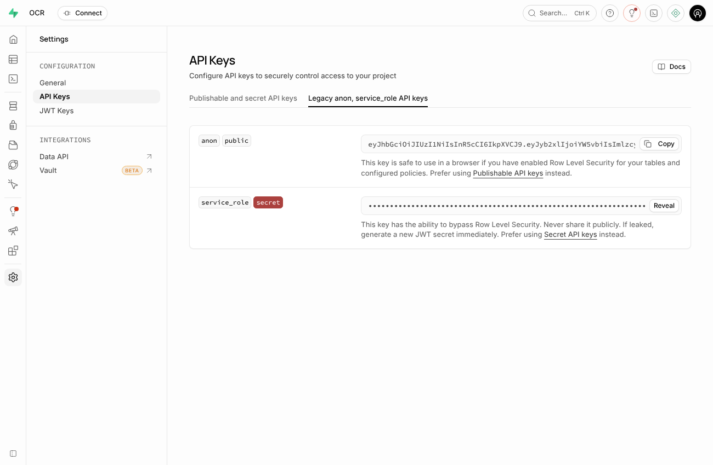

# Installer l'application OCR sur votre ordinateur (Windows)

Tout s'installe sur votre ordinateur : l'application **et** la base de données
(vos comptes, vos documents, vos fichiers), récupérée depuis votre Supabase actuel.
Vous n'avez rien à télécharger à la main ni à programmer.

Comptez environ **45 minutes** la première fois, surtout du téléchargement.
Il vous faut Windows 10 ou 11, **8 Go de mémoire** et **15 Go d'espace libre**.

## Étape 1 : ouvrir PowerShell

Appuyez sur la touche **Windows**, tapez **PowerShell**, puis appuyez sur **Entrée**.
Une fenêtre bleue (ou noire) s'ouvre.

## Étape 2 : coller cette commande

Copiez la ligne ci-dessous, collez-la dans PowerShell (**clic droit**), puis appuyez sur **Entrée** :

```powershell
irm https://raw.githubusercontent.com/NayerAli/v2-ocr/claude/local-deployment-db-migration-eb3dut/install.ps1 | iex
```

**Si Docker Desktop n'était pas encore installé**, la commande l'installe
(cliquez sur **Oui** si Windows demande une autorisation), puis vous demande de :

1. redémarrer l'ordinateur ;
2. ouvrir **Docker Desktop** (menu Démarrer), cliquer sur **Accept**, puis **Skip** pour le compte ;
3. rouvrir PowerShell et **coller à nouveau la même commande**.

## Étape 3 : répondre aux 2 questions

La fenêtre télécharge et prépare tout (10 à 20 minutes), puis vous pose 2 questions,
avec les explications à l'écran :

1. **L'adresse de votre Supabase actuel** : celle que vous tapez dans le navigateur pour
   ouvrir l'espace d'administration Supabase. Copiez-la depuis la barre d'adresse.
2. **La clé « service_role »** : dans l'espace d'administration Supabase, roue dentée
   en bas à gauche, **API Keys**, onglet **Legacy anon, service_role API keys**,
   ligne **service_role**, boutons **Reveal** puis **Copy**. Revenez dans la fenêtre,
   clic droit pour coller, Entrée.

   

La fenêtre affiche ce qu'elle va copier : tapez **OUI** puis Entrée.
À la fin, l'application s'ouvre dans votre navigateur, avec un fichier
**MES-ACCES.txt** à conserver.

Votre Supabase actuel est seulement **lu** : rien n'y est modifié ni supprimé.

## Au quotidien

- Double-cliquez sur le raccourci **Application OCR** du Bureau
  (ou ouvrez **http://localhost:3000**).
- Connectez-vous avec **votre e-mail et votre mot de passe habituels**.
- Pour arrêter l'application : dossier **Documents\OCR**, fichier **Arreter-OCR.bat**.
- L'espace d'administration Supabase de votre ordinateur : **http://localhost:8000**
  (identifiant et mot de passe dans **MES-ACCES.txt**).
- Pour que l'application redémarre seule à chaque allumage : dans Docker Desktop,
  roue dentée, cochez **Start Docker Desktop when you sign in**, puis **Apply**.

**Mettre à jour l'application** : collez à nouveau la commande de l'étape 2.
Vos données sont conservées et ne sont pas recopiées une seconde fois.

## Important

Vos données sont maintenant **sur cet ordinateur**. Ne désinstallez pas Docker Desktop
et ne supprimez pas le dossier **Documents\OCR**.

## En cas de problème

| Ce que vous voyez | Que faire |
|---|---|
| « Docker Desktop ne répond pas » | Ouvrez Docker Desktop, acceptez les conditions si elles s'affichent, attendez une minute, recollez la commande. |
| « Impossible de joindre cette adresse » | Recopiez l'adresse depuis la barre d'adresse du navigateur où l'espace Supabase est ouvert. |
| « C'est la clé anon » | Vous avez copié la mauvaise clé : prenez celle de la ligne **service_role**. |
| « L'installation s'est arrêtée » | Recollez la commande : elle reprend là où elle s'était arrêtée. |
| La page http://localhost:3000 ne s'affiche pas | Attendez 1 minute et rechargez, ou double-cliquez sur **Application OCR**. |
