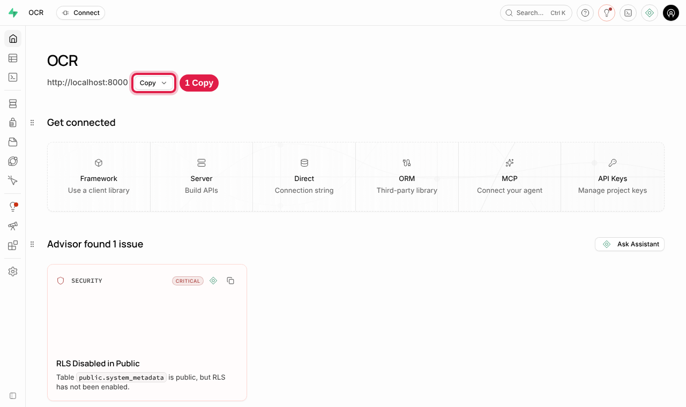
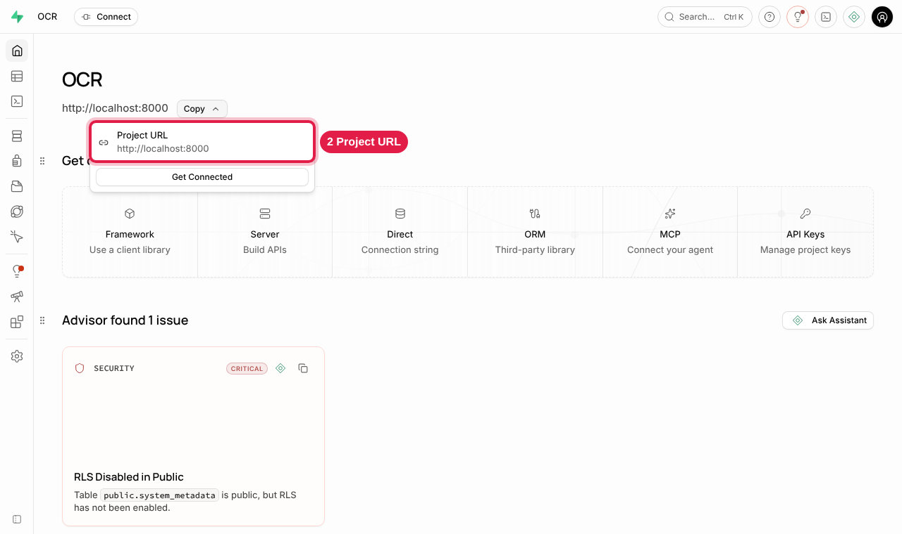
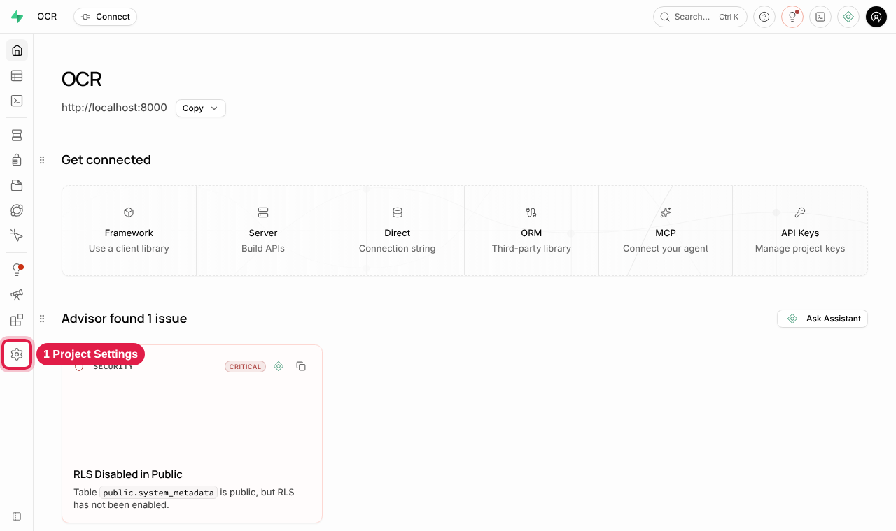
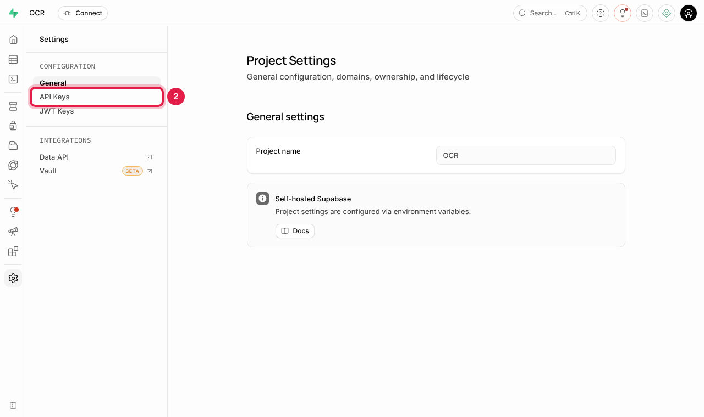
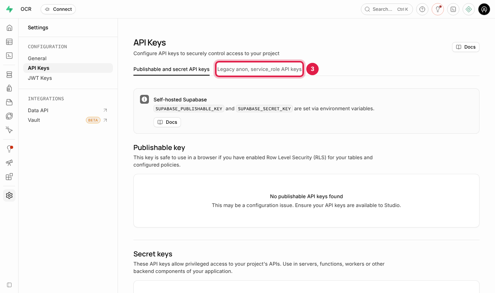
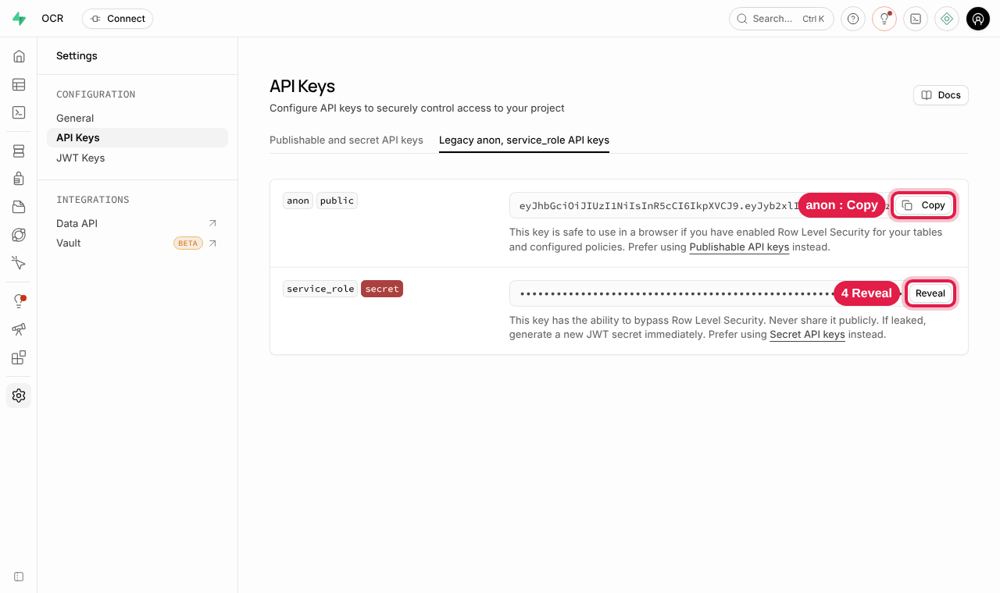
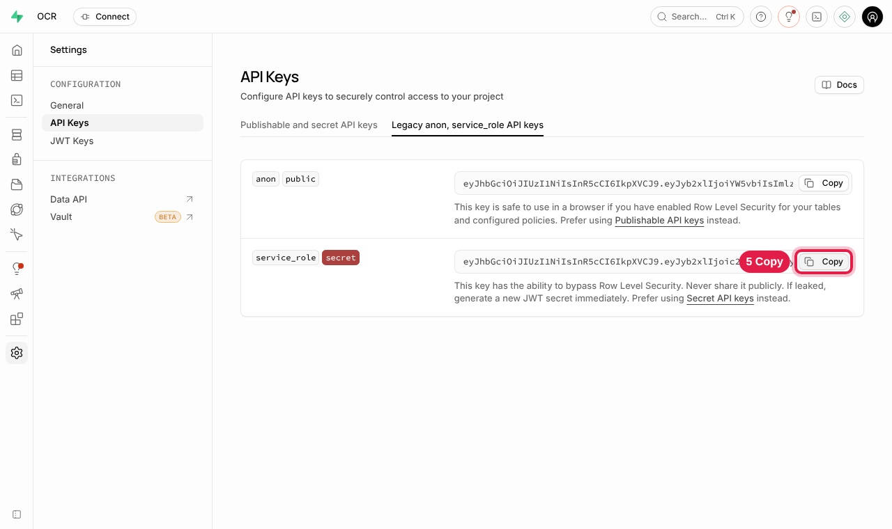
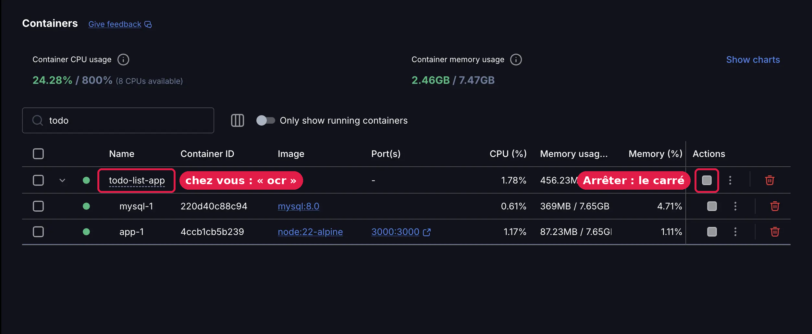
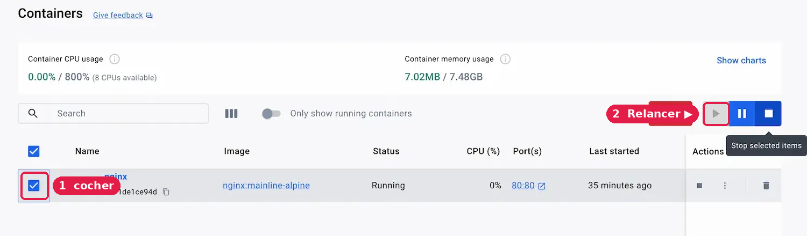

# Installer l'application OCR sur votre ordinateur (Windows)

Tout s'installe sur votre ordinateur : l'application **et** la base de données
(vos comptes, vos documents, vos fichiers), récupérée depuis votre Supabase actuel.
Vous n'avez rien à télécharger à la main ni à programmer.

Comptez environ **45 minutes** la première fois, surtout du téléchargement.
Il vous faut Windows 10 ou 11, **8 Go de mémoire** et **15 Go d'espace libre**.

## Étape 1 : ouvrir PowerShell

Appuyez sur la touche **Windows**, tapez **PowerShell**, puis appuyez sur **Entrée**.
Une fenêtre bleue (ou noire) s'ouvre.

## Étape 2 : coller cette commande

Copiez la ligne ci-dessous, collez-la dans PowerShell (**clic droit**), puis appuyez sur **Entrée** :

```powershell
irm https://raw.githubusercontent.com/NayerAli/v2-ocr/claude/local-deployment-db-migration-eb3dut/install.ps1 | iex
```

La fenêtre vous guide et vous demande votre accord à chaque étape :

- **Docker Desktop** (logiciel gratuit nécessaire) : s'il n'est pas installé, elle vous
  propose de l'installer. Tapez **O** pour accepter (cliquez ensuite sur **Oui** si
  Windows demande une autorisation) ou **N** pour refuser.
- **Le dossier d'installation** : elle propose `Documents\OCR`. Appuyez sur **Entrée**
  pour l'accepter, ou tapez un autre chemin (par exemple `D:\Applications\OCR`).
- **Le raccourci sur le Bureau** : tapez **O** si vous le voulez, **N** sinon.

Si Docker Desktop vient d'être installé, il faut ensuite :

1. redémarrer l'ordinateur ;
2. ouvrir **Docker Desktop** (menu Démarrer), cliquer sur **Accept**, puis **Skip** pour le compte ;
3. rouvrir PowerShell et **coller à nouveau la même commande**.

## Étape 3 : répondre aux 2 questions

La fenêtre télécharge et prépare tout (10 à 20 minutes), puis vous pose 2 questions.
Gardez l'espace d'administration Supabase ouvert dans votre navigateur : vous allez
y copier deux informations.

### Question 1 : l'adresse de votre Supabase

Sur la page d'accueil de l'espace d'administration Supabase :

**1.** Sous le nom du projet, cliquez sur **Copy**.



**2.** Cliquez sur **Project URL** : l'adresse est copiée.



Revenez dans la fenêtre PowerShell, **clic droit** pour coller, puis **Entrée**.

> Si l'adresse copiée commence par `http://localhost`, la fenêtre vous le signalera :
> copiez alors plutôt l'adresse affichée dans la **barre d'adresse** de votre navigateur.

### Question 2 : la clé « service_role »

**1.** En bas à gauche, cliquez sur la **roue dentée** (Project Settings).



**2.** Dans le menu, cliquez sur **API Keys**.



**3.** Cliquez sur l'onglet **Legacy anon, service_role API keys**.



**4.** Deux clés s'affichent :

- en haut, la clé **anon** (publique). Son bouton **Copy** la copie, mais **l'assistant n'en a pas besoin** ;
- en bas, la clé **service_role** (étiquette rouge « secret ») : c'est **celle-ci**.
  Cliquez sur **Reveal** pour l'afficher.



**5.** Cliquez sur **Copy** sur la ligne **service_role**.



Revenez dans la fenêtre PowerShell, **clic droit** pour coller, puis **Entrée**.
Si vous collez la clé anon par erreur, la fenêtre vous le dira.

### Fin de l'installation

La fenêtre affiche ce qu'elle va copier : tapez **OUI** puis Entrée.
À la fin, l'application s'ouvre dans votre navigateur, avec un fichier
**MES-ACCES.txt** à conserver.

Votre Supabase actuel est seulement **lu** : rien n'y est modifié ni supprimé.

## Au quotidien

- Ouvrez **http://localhost:3000** (ou le raccourci **Application OCR** du Bureau).
- Connectez-vous avec **votre e-mail et votre mot de passe habituels**.
- Tant que Docker Desktop est ouvert, l'application fonctionne.
- Pour que l'application démarre seule à chaque allumage : dans Docker Desktop,
  roue dentée, cochez **Start Docker Desktop when you sign in**, puis **Apply**.
- L'espace d'administration Supabase de votre ordinateur : **http://localhost:8000**
  (identifiant et mot de passe dans **MES-ACCES.txt**).

### Arrêter ou relancer l'application (dans Docker Desktop)

Ouvrez **Docker Desktop**, puis cliquez sur **Containers** dans le menu de gauche.
L'application apparaît sous la forme d'un groupe nommé **ocr**.

**Arrêter** : sur la ligne **ocr**, cliquez sur le **carré** dans la colonne *Actions*.



**Relancer** : cochez la case de la ligne **ocr**, puis cliquez sur le **triangle ▶**
en haut à droite (ou sur le triangle ▶ qui remplace le carré dans la colonne *Actions*).



Vos données sont conservées quand vous arrêtez l'application.
N'utilisez **jamais** la corbeille rouge (Delete) sur la ligne **ocr**.

*Captures Docker Desktop : documentation officielle de Docker (docs.docker.com,
licence Apache 2.0), annotées. Les noms affichés y sont des exemples : chez vous,
le groupe s'appelle **ocr**.*

**Mettre à jour l'application** : collez à nouveau la commande de l'étape 2 et
appuyez sur **Entrée** quand elle propose le dossier (elle se souvient de celui choisi).
Vos données sont conservées et ne sont pas recopiées une seconde fois.

## Important

Vos données sont maintenant **sur cet ordinateur**. Ne désinstallez pas Docker Desktop
et ne supprimez pas le dossier d'installation.

## En cas de problème

| Ce que vous voyez | Que faire |
|---|---|
| « Docker Desktop ne répond pas » | Ouvrez Docker Desktop, acceptez les conditions si elles s'affichent, attendez une minute, recollez la commande. |
| « Cette adresse (localhost) ne désigne pas le serveur » | Copiez l'adresse de la barre d'adresse du navigateur où l'espace Supabase est ouvert. |
| « Impossible de joindre cette adresse » | Vérifiez l'adresse, puis recollez-la. |
| « C'est la clé anon » | Vous avez copié la clé du haut : prenez celle de la ligne **service_role** (étapes 4 et 5). |
| « L'installation s'est arrêtée » | Recollez la commande : elle reprend là où elle s'était arrêtée. |
| La page http://localhost:3000 ne s'affiche pas | Dans Docker Desktop, relancez le groupe **ocr** (voir plus haut), attendez 1 minute et rechargez. |
